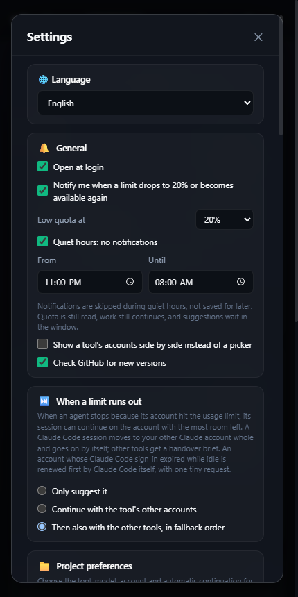
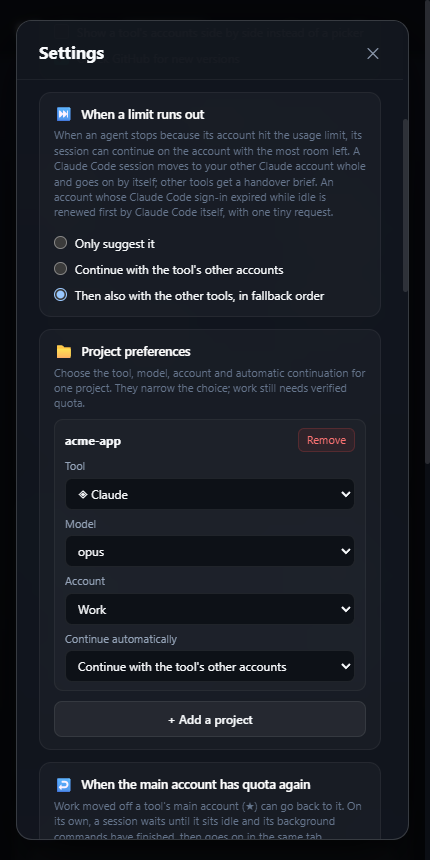
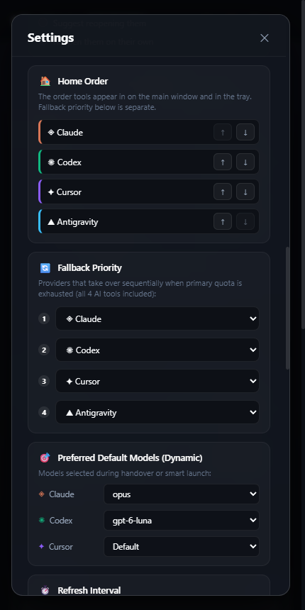
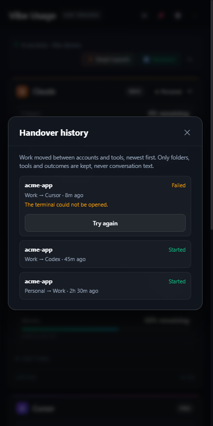
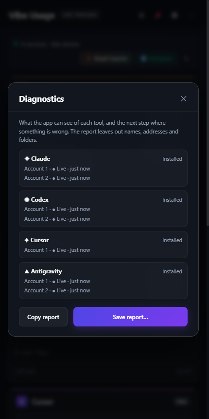

<div align="center">

[English](../../README.md) · [Türkçe](README.tr.md) · [Deutsch](README.de.md) · **Español** · [Français](README.fr.md) · [Italiano](README.it.md) · [Português](README.pt.md) · [Nederlands](README.nl.md) · [Polski](README.pl.md) · [日本語](README.ja.md) · [한국어](README.ko.md) · [简体中文](README.zh.md) · [Русский](README.ru.md)


# Vibe Usage

**Todas las suscripciones de programación con IA que pagas, en una sola ventana de la barra de menús.**

Mira cuánta cuota les queda a Claude Code, Codex, Cursor y Antigravity, abre la herramienta que todavía tiene margen y
pasa una tarea a medias de una herramienta a otra sin tener que volver a explicarla.

Bandeja de Windows · barra de menús de macOS · 13 idiomas · sin contraseñas, sin tokens guardados

**[Descargar para Windows y macOS](https://github.com/mustafacagri/vibe-usage/releases/latest)** · Terminal: [`npm install -g vibe-usage-cli`](https://www.npmjs.com/package/vibe-usage-cli)


<sub>[Ver en resolución completa (MP4)](../media/demo.mp4)</sub>

</div>

> Esta traducción puede ir por detrás del README en inglés; la [versión en inglés](../../README.md) es la de referencia.

## Por qué

Si programas con varias herramientas de IA, chocas una y otra vez con el mismo muro: el límite de 5 horas se agota a
mitad de la tarea, abres otra herramienta y empiezas a explicarlo todo desde cero. Cada proveedor muestra su uso en un
sitio distinto, y algunos ni lo muestran.

Vibe Usage lee las sesiones que ya tienes iniciadas en tu equipo y muestra todos los límites uno al lado del otro:
cuánto queda y cuándo se reinicia. Cuando a una herramienta le queda poco, abre la siguiente con cuota verificada en tu
carpeta de proyecto y escribe un resumen de la sesión actual para que la nueva herramienta continúe donde se quedó la
anterior.

## Funciones

<table>
<tr>
<td width="50%" valign="top">

### Cuotas de un vistazo

Cada límite de cada cuenta: ventanas de 5 horas y semanales, cuotas por modelo y bolsas de gasto. Las cuentas atrás
indican cuándo se reinicia cada una. Si una actualización falla, la última lectura sigue visible y se marca claramente
como desactualizada. Los valores desconocidos nunca se muestran como cuota completa. Pasa el puntero sobre el icono de
la bandeja para ver lo que le queda a cada herramienta; si quieres, recibe un aviso cuando un límite se agote o vuelva a
estar disponible. La app puede abrirse al iniciar sesión.

</td>
<td width="50%" valign="top">


</td>
</tr>
<tr>
<td valign="top">

### Inicio Inteligente

Elige la primera herramienta de tu orden de prioridad cuya cuota tiene margen **verificado** y la abre en una terminal
nueva en la carpeta de proyecto que elijas. Si no puede verificar ninguna, lo dice en lugar de adivinar.

</td>
<td valign="top">


</td>
</tr>
<tr>
<td valign="top">

### Transferir

Elige una sesión de Claude Code, Codex, Cursor Agent o Antigravity. Vibe Usage la resume en `VIBE_HANDOVER.md` dentro de
la carpeta del proyecto: el objetivo, los últimos turnos, los archivos tocados y el estado de git. Después abre la
herramienta de destino con una instrucción para leer ese resumen. Solo se muestran las sesiones iniciadas en la carpeta
elegida.

</td>
<td valign="top">


</td>
</tr>
<tr>
<td valign="top">

### Varias cuentas

Claude y Codex guardan una sesión por carpeta de perfil. **Añadir cuenta** crea una carpeta nueva y abre allí el inicio
de sesión de la herramienta; las carpetas `~/.claude-*` y `~/.codex-*` que hayas creado tú se detectan automáticamente.
Cada cuenta se muestra con el correo con el que inició sesión, y cada cuenta de Antigravity con sesión iniciada también
se sigue por separado. Elige la cuenta principal, abre Claude Code con una cuenta concreta y define el orden de respaldo
y el modelo preferido de cada herramienta.
Si el inicio de sesión no termina en diez minutos, la cuenta se quita de nuevo y la siguiente reutiliza su carpeta.

</td>
<td valign="top">


</td>
</tr>
</table>

### Ajustes, historial y diagnóstico

<table>
<tr>
<td width="33%" valign="top"></td>
<td width="33%" valign="top"></td>
<td width="33%" valign="top"></td>
</tr>
<tr>
<td valign="top"><b>General:</b> abrir al iniciar sesión, avisos en tu límite de cuota baja, horas de silencio, cuentas lado a lado y la búsqueda de actualizaciones.</td>
<td valign="top"><b>Cuando se agota un límite:</b> solo sugerirlo, seguir en las otras cuentas de la herramienta o después en las otras herramientas por orden de respaldo; también por proyecto.</td>
<td valign="top"><b>Orden y modelos:</b> cómo se listan las herramientas, cuál toma el relevo, con qué modelo arranca cada una y cada cuánto se lee la cuota.</td>
</tr>
<tr>
<td width="33%" valign="top"></td>
<td width="33%" valign="top"></td>
<td></td>
</tr>
<tr>
<td valign="top"><b>Historial de traspasos:</b> qué trabajo pasó de qué cuenta a cuál; reintenta uno fallido con un clic.</td>
<td valign="top"><b>Diagnóstico:</b> si cada herramienta está instalada y cómo está cada cuenta; un informe sin nombres ni carpetas para copiar o guardar.</td>
<td></td>
</tr>
</table>

## Herramientas compatibles

| Herramienta | De dónde sale la cuota                                                    | Sesiones para transferir                       | Inicio                                 |
| ----------- | ------------------------------------------------------------------------- | ---------------------------------------------- | -------------------------------------- |
| Claude Code | Endpoint de uso OAuth del perfil (Llavero en macOS)                       | `~/.claude/projects`                           | CLI `claude` con el perfil elegido     |
| Codex       | Métodos de límites del app-server de la CLI instalada                     | `~/.codex/sessions`                            | CLI `codex`                            |
| Cursor      | Resumen de uso de la sesión iniciada                                      | Chats de Cursor Agent CLI (`~/.cursor/chats`)  | `cursor-agent`; si no, la app          |
| Antigravity | Servicio local de la app en ejecución (proceso y puerto verificados)      | `~/.gemini/antigravity-ide`                    | App de Antigravity                     |

Las listas de modelos salen de los datos de cada herramienta: los alias de Claude Code y los modelos que has usado, la
caché de modelos de Codex y `cursor-agent --list-models` (en caché durante 24 horas).

## Privacidad y seguridad

- **Solo lectura.** Usa las sesiones que ya existen. Nunca pide una contraseña, nunca guarda un token, nunca
  cierra tu sesión y nunca toca el trabajo en curso.
- **Inicio de sesión caducado.** Cuando el trabajo puede pasar solo de una cuenta a otra, el propio Claude Code renueva un inicio de sesión caducado: con una petición mínima a Haiku (una palabra, sin herramientas, nada guardado), como mucho cada 30 minutos por cuenta. La app nunca lee ni usa el token de actualización.
- **Dos endpoints.** Las peticiones de cuota solo van a los endpoints de uso de Anthropic y Cursor, con la verificación
  TLS activada. Codex y Antigravity se leen en local.
- **Nada secreto en disco.** Los ajustes se guardan en `%APPDATA%\Vibe Usage\settings.json` (Windows) o
  `~/Library/Application Support/Vibe Usage/settings.json` (macOS). Las cuotas solo se guardan en memoria.
- **Una app blindada.** La ventana se ejecuta en un sandbox con una CSP estricta, no puede navegar ni abrir otras
  ventanas y solo responde a su propia página. Los fuses de Electron desactivan `runAsNode`, `NODE_OPTIONS` y el
  inspector, y exigen la integridad de ASAR.

## Instalación

### Windows

Descarga `Vibe-Usage-<versión>-win-setup.exe` de la [última versión](https://github.com/mustafacagri/vibe-usage/releases/latest) y ejecútalo: se instala solo para tu usuario, sin permisos de administrador. O usa el portable `Vibe-Usage-<versión>-win-x64.zip` (o `-arm64`), descomprímelo y ejecuta `Vibe Usage.exe`. La app instalada se mantiene al día: la nueva versión se descarga en segundo plano y se instala con **Reiniciar para actualizar**. La copia portable enlaza a la nueva versión. Vive en la bandeja del sistema.

La app no está firmada, así que en el primer arranque Windows SmartScreen puede mostrar **Windows protegió su PC**. Haz clic en **Más información** y luego en **Ejecutar de todas formas**.

### macOS

Descarga `Vibe-Usage-<versión>-mac-arm64.dmg` (Apple silicon; Intel: `-mac-x64.dmg`) de la [última versión](https://github.com/mustafacagri/vibe-usage/releases/latest), ábrelo y arrastra **Vibe Usage** a Aplicaciones. La app aún no está firmada con un Apple Developer ID, así que Gatekeeper bloquea el primer inicio: abre **Ajustes del Sistema › Privacidad y seguridad** y pulsa **Abrir igualmente**, o ejecuta:

```sh
xattr -dr com.apple.quarantine "/Applications/Vibe Usage.app"
```

Para saltarte ese paso, compílala tú mismo. Solo necesitas Node.js 24:

```sh
git clone https://github.com/mustafacagri/vibe-usage.git && cd vibe-usage
npm ci
npm run build:mac
cp -R "release/mac-arm64/Vibe Usage.app" /Applications/
```

En un Mac Intel la carpeta es `release/mac`. Una app compilada por ti no queda en cuarentena y se abre directamente. macOS solo deja que una app firmada se reemplace a sí misma, así que cada nueva versión se instala del mismo modo: el botón **Descargar** de la app baja la imagen de disco para tu Mac.

## Línea de comandos

Los mismos datos están disponibles en la terminal, en Windows y macOS, con o sin la app de escritorio. Necesita Node.js 24 o posterior y lee las mismas sesiones iniciadas que la app; si ambas están instaladas, comparten ajustes e idioma.

```sh
npm install -g vibe-usage-cli
vibe-usage status
```


```sh
vibe-usage status [--json]   # la cuota de todas las cuentas una vez; --json para scripts
vibe-usage watch             # lo mismo, actualizado hasta Ctrl+C
vibe-usage run <claude|codex|cursor> [--account ID] [--cwd PATH] [--model MODEL] [--dry-run]
vibe-usage handover [--from TOOL] [--to TOOL] [--session ID] [--cwd PATH]
vibe-usage help
```

Para probarlo sin instalar, ejecuta `npx vibe-usage-cli status`.

`run` inicia la herramienta en esta terminal con una cuenta de cuota verificada; si no la hay, indica una con `--account` (los ID están en `status --json`). `--dry-run` muestra la cuenta y el comando sin iniciar nada. `handover` escribe `VIBE_HANDOVER.md` para la sesión más reciente de la carpeta (o `--session`) y abre con él la herramienta de destino.

## Desarrollo

Consulta los comandos, la estructura del proyecto y las variables de entorno en la
[sección «Development» del README en inglés](../../README.md#development).

## Limitaciones

- La versión de macOS no está notarizada (ver [macOS](#macos)).
- El modelo de una sesión de Antigravity sale de un registro local no documentado; si no se puede leer, queda en blanco.
- Los chats de Cursor IDE (Composer) no se pueden transferir; solo se leen las sesiones de Cursor Agent CLI.

## Licencia

[MIT](../../LICENSE)
