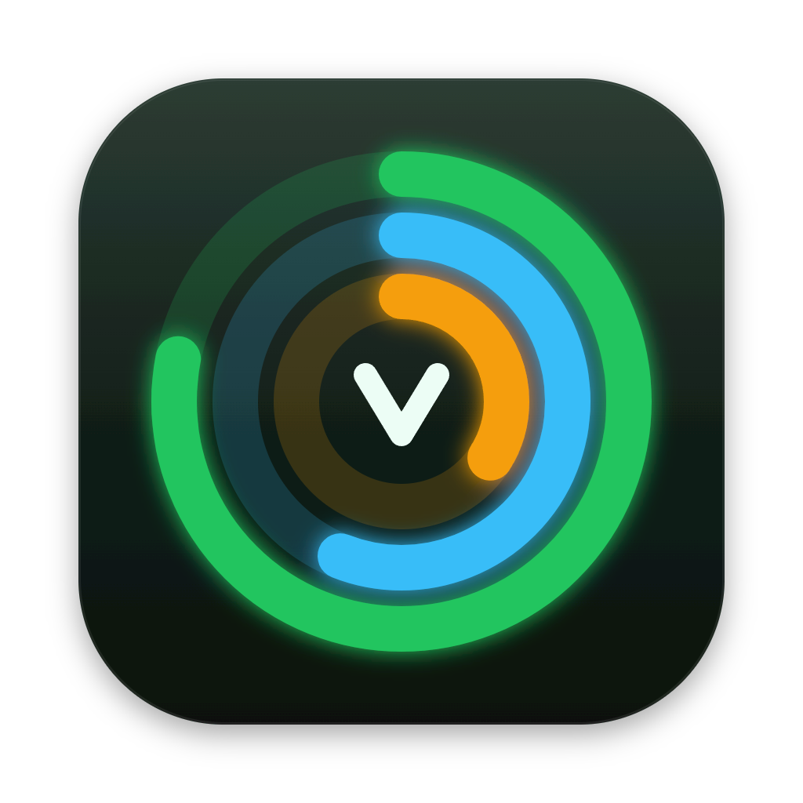
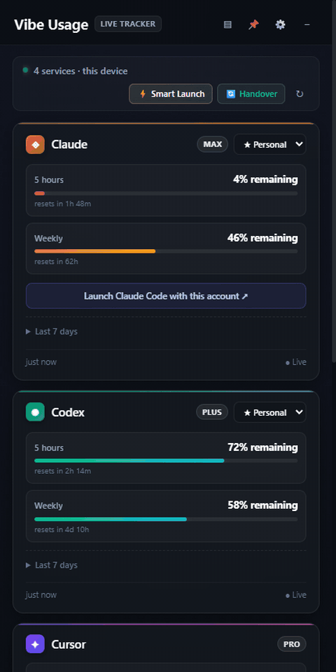
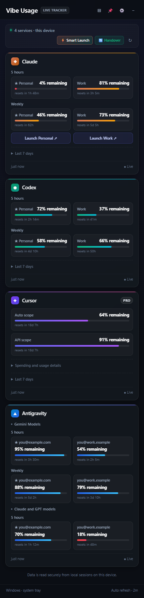
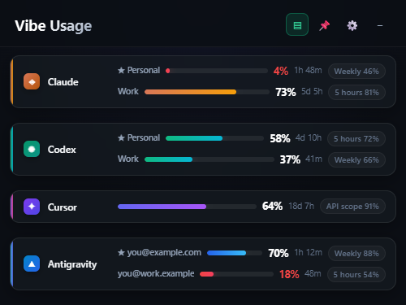
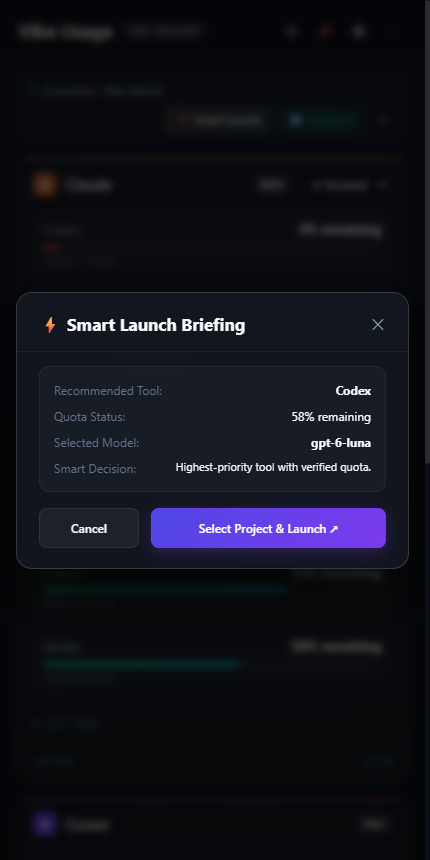
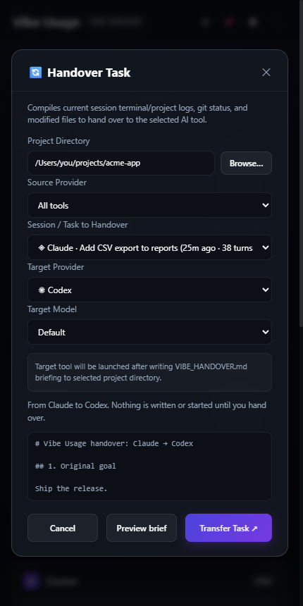
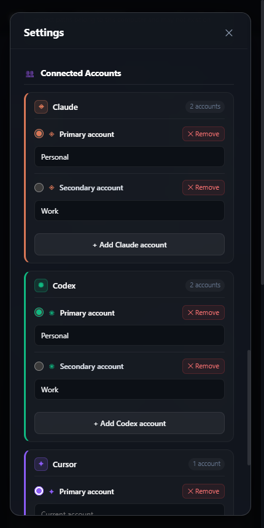
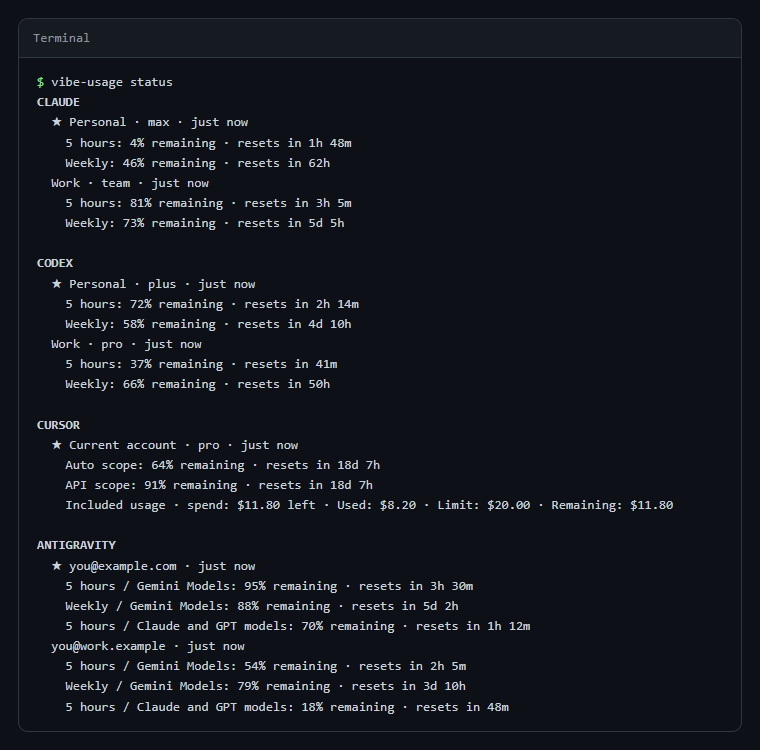

<div align="center">

[English](../../README.md) · [Türkçe](README.tr.md) · [Deutsch](README.de.md) · [Español](README.es.md) · [Français](README.fr.md) · [Italiano](README.it.md) · [Português](README.pt.md) · [Nederlands](README.nl.md) · **Polski** · [日本語](README.ja.md) · [한국어](README.ko.md) · [简体中文](README.zh.md) · [Русский](README.ru.md)



# Vibe Usage

**Wszystkie opłacane subskrypcje AI do programowania w jednym oknie paska menu.**

Sprawdź, ile limitu zostało w Claude Code, Codex, Cursor i Antigravity, uruchom narzędzie, które ma jeszcze zapas, i
przekaż niedokończone zadanie z jednego narzędzia do drugiego bez tłumaczenia go od nowa.

Zasobnik systemowy Windows · pasek menu macOS · 13 języków · bez haseł, bez zapisanych tokenów



<sub>[Obejrzyj w pełnej rozdzielczości (MP4)](../media/demo.mp4)</sub>

</div>

> To tłumaczenie może być opóźnione względem angielskiego README; wiążąca jest [wersja angielska](../../README.md).

## Dlaczego

Jeśli programujesz z kilkoma narzędziami AI, wciąż uderzasz w ten sam mur: 5-godzinny limit kończy się w połowie
zadania, otwierasz inne narzędzie i zaczynasz wszystko tłumaczyć od zera. Każdy dostawca pokazuje zużycie w innym
miejscu, a niektórzy wcale.

Vibe Usage odczytuje sesje, które są już zalogowane na Twoim komputerze, i pokazuje wszystkie limity obok siebie: ile
zostało i kiedy nastąpi reset. Gdy w jednym narzędziu zaczyna brakować limitu, uruchamia kolejne ze zweryfikowanym
limitem w folderze projektu i zapisuje podsumowanie bieżącej sesji, aby nowe narzędzie kontynuowało tam, gdzie
poprzednie skończyło.

## Funkcje

<table>
<tr>
<td width="50%" valign="top">

### Limity w jednym spojrzeniu

Każdy limit każdego konta: okna 5-godzinne i tygodniowe, limity dla poszczególnych modeli, pule wydatków. Odliczanie
pokazuje, kiedy każdy z nich się zresetuje. Jeśli odświeżenie się nie powiedzie, ostatni odczyt pozostaje widoczny i
jest wyraźnie oznaczony jako nieaktualny. Nieznane wartości nigdy nie są pokazywane jako pełny limit. Najedź na ikonę w
zasobniku, aby zobaczyć, ile zostało w każdym narzędziu; opcjonalnie otrzymasz powiadomienie, gdy limit się kończy lub
znów jest dostępny. Aplikacja może uruchamiać się po zalogowaniu.

</td>
<td width="50%" valign="top">





</td>
</tr>
<tr>
<td valign="top">

### Inteligentny Start

Wybiera pierwsze narzędzie w Twojej kolejności priorytetów, którego limit ma **zweryfikowany** zapas, i otwiera je w
nowym terminalu w wybranym folderze projektu. Jeśli nie da się zweryfikować żadnego narzędzia, mówi o tym zamiast
zgadywać.

</td>
<td valign="top">



</td>
</tr>
<tr>
<td valign="top">

### Przekaż zadanie

Wybierz sesję z Claude Code, Codex, Cursor Agent lub Antigravity. Vibe Usage podsumowuje ją w pliku `VIBE_HANDOVER.md`
w folderze projektu: cel, ostatnie wymiany, zmienione pliki i stan gita. Następnie uruchamia narzędzie docelowe z
poleceniem przeczytania tego podsumowania. Wyświetlane są tylko sesje rozpoczęte w wybranym folderze.

</td>
<td valign="top">



</td>
</tr>
<tr>
<td valign="top">

### Wiele kont

Claude i Codex przechowują jedno logowanie na folder profilu. **Dodaj konto** tworzy nowy folder i otwiera w nim
logowanie narzędzia; foldery `~/.claude-*` i `~/.codex-*` utworzone samodzielnie są wykrywane automatycznie. Każde konto
jest pokazywane z adresem e-mail, którym się zalogowano, a każde zalogowane konto Antigravity również jest śledzone
osobno. Wybierz konto główne, uruchom Claude Code z konkretnym kontem i ustaw kolejność zapasową oraz preferowany model
dla każdego narzędzia.
Logowanie nieukończone w ciągu dziesięciu minut ponownie usuwa konto, a następne konto używa jego folderu.

</td>
<td valign="top">



</td>
</tr>
</table>

## Obsługiwane narzędzia

| Narzędzie   | Skąd pochodzi limit                                                       | Sesje do przekazania                           | Uruchamianie                             |
| ----------- | ------------------------------------------------------------------------- | ---------------------------------------------- | ---------------------------------------- |
| Claude Code | Punkt końcowy użycia OAuth profilu (Pęk kluczy w macOS)                   | `~/.claude/projects`                           | CLI `claude` z wybranym profilem         |
| Codex       | Metody limitów app-servera zainstalowanego CLI                            | `~/.codex/sessions`                            | CLI `codex`                              |
| Cursor      | Podsumowanie użycia zalogowanej sesji                                     | Czaty Cursor Agent CLI (`~/.cursor/chats`)     | `cursor-agent`, w przeciwnym razie aplikacja |
| Antigravity | Lokalna usługa działającej aplikacji (proces i port zweryfikowane)        | `~/.gemini/antigravity-ide`                    | Aplikacja Antigravity                    |

Listy modeli pochodzą z danych każdego narzędzia: aliasy Claude Code i używane przez Ciebie modele, pamięć podręczna
modeli Codex oraz `cursor-agent --list-models` (przechowywane przez 24 godziny).

## Prywatność i bezpieczeństwo

- **Tylko odczyt.** Korzysta z istniejących sesji. Nigdy nie prosi o hasło, nie zapisuje tokenów, nie
  wylogowuje Cię i nie ingeruje w trwającą pracę.
- **Wygasłe logowanie.** Gdy praca może sama przechodzić między kontami, wygasłe logowanie Claude Code odnawia sam Claude Code: jednym minimalnym zapytaniem do Haiku (jedno słowo, bez narzędzi, nic nie jest zapisywane), najwyżej raz na 30 minut na konto. Aplikacja nigdy nie czyta ani nie używa tokenu odświeżania.
- **Dwa punkty końcowe.** Zapytania o limity trafiają tylko do punktów końcowych użycia Anthropic i Cursor, z włączoną
  weryfikacją TLS. Codex i Antigravity są odczytywane lokalnie.
- **Żadnych sekretów na dysku.** Ustawienia są w `%APPDATA%\Vibe Usage\settings.json` (Windows) lub
  `~/Library/Application Support/Vibe Usage/settings.json` (macOS). Limity są trzymane wyłącznie w pamięci.
- **Zabezpieczona aplikacja.** Okno działa w piaskownicy ze ścisłą CSP, nie może nawigować ani otwierać innych okien i
  odpowiada tylko własnej stronie. Fuse'y Electrona wyłączają `runAsNode`, `NODE_OPTIONS` i inspektor oraz wymuszają
  integralność ASAR.

## Instalacja

### Windows

Pobierz `Vibe-Usage-<wersja>-win-x64.zip` (lub `-arm64`) z
[Releases](https://github.com/mustafacagri/vibe-usage/releases), rozpakuj i uruchom `Vibe Usage.exe`. Aplikacja działa
w zasobniku systemowym.

Aplikacja nie jest podpisana, więc przy pierwszym uruchomieniu Windows SmartScreen może wyświetlić **System Windows ochronił ten komputer**. Kliknij **Więcej informacji**, a potem **Uruchom mimo to**.

### macOS

Aplikacja nie jest jeszcze podpisana Apple Developer ID, więc najprościej zbudować ją samodzielnie. Potrzebujesz tylko
Node.js 24:

```sh
git clone https://github.com/mustafacagri/vibe-usage.git && cd vibe-usage
npm ci
npm run build:mac
cp -R "release/mac-arm64/Vibe Usage.app" /Applications/
```

Na Macu z procesorem Intel folder nazywa się `release/mac`. Aplikacja zbudowana samodzielnie nie trafia do kwarantanny i
otwiera się od razu. Jeśli zamiast tego pobierzesz `.zip` lub `.dmg`, Gatekeeper zablokuje ją przy pierwszym
uruchomieniu: kliknij aplikację prawym przyciskiem i wybierz **Otwórz** albo uruchom:

```sh
xattr -dr com.apple.quarantine "/Applications/Vibe Usage.app"
```

## Wiersz poleceń

Te same dane są dostępne w terminalu, w systemach Windows i macOS, z aplikacją desktopową lub bez niej. Wymaga Node.js 24 lub nowszego; CLI czyta te same zalogowane sesje co aplikacja, a gdy obie są zainstalowane, dzielą ustawienia i język.

```sh
npm install -g vibe-usage
vibe-usage status
```



```sh
vibe-usage status [--json]   # limit wszystkich kont, jednorazowo; --json dla skryptów
vibe-usage watch             # to samo, odświeżane do Ctrl+C
vibe-usage run <claude|codex|cursor> [--account ID] [--cwd PATH] [--model MODEL] [--dry-run]
vibe-usage handover [--from TOOL] [--to TOOL] [--session ID] [--cwd PATH]
vibe-usage help
```

Aby wypróbować bez instalacji, uruchom `npx vibe-usage status`.

`run` uruchamia narzędzie w tym terminalu na koncie ze zweryfikowanym limitem; w przeciwnym razie wskaż konto przez `--account` (identyfikatory są w `status --json`). `--dry-run` wypisuje konto i polecenie, niczego nie uruchamiając. `handover` zapisuje `VIBE_HANDOVER.md` dla najnowszej sesji folderu (lub `--session`) i otwiera z nim narzędzie docelowe.

## Rozwój

Polecenia, strukturę projektu i zmienne środowiskowe opisuje
[sekcja „Development” angielskiego README](../../README.md#development).

## Ograniczenia

- Wersja na macOS nie jest notaryzowana (zobacz [macOS](#macos)).
- Model sesji Antigravity pochodzi z nieudokumentowanego lokalnego zapisu; jeśli nie da się go odczytać, pozostaje pusty.
- Czatów z Cursor IDE (Composer) nie można przekazać; odczytywane są tylko sesje Cursor Agent CLI.

## Licencja

[MIT](../../LICENSE)
